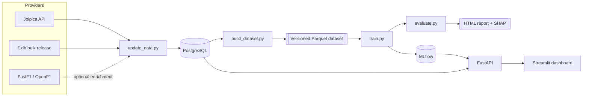

# F1 Championship Predictor

[](https://github.com/AntonioLoLa/f1-champion-predictor/actions/workflows/ci.yml)
[](https://github.com/AntonioLoLa/f1-champion-predictor/actions/workflows/nightly-update.yml)
[](LICENSE)
[](pyproject.toml)

After every Grand Prix, estimates each driver's probability of winning that season's
Formula 1 World Drivers' Championship — trained on the full history of the sport
(1950–present), served over a versioned API, and presented on a live dashboard.

This is a portfolio project built to the standard of a company's production ML platform:
a real data pipeline against three external providers, PostgreSQL + SQLAlchemy, a leakage-
audited feature layer, six competing model families tracked in MLflow, calibrated and
group-normalized probabilities, SHAP explainability, a FastAPI service, a Streamlit
dashboard, Docker Compose, and CI. No notebooks — every pipeline stage is a tested,
re-runnable module.

## The problem, honestly stated

Exactly **one driver wins the championship per season**. Restricting to the modern points
era (1981+) gives roughly 45 independent positive labels, not the 19,000+ driver-round rows
in the training set — and by round 20 of 24, the title is often already mathematically
decided. A single global ROC AUC on this problem is close to meaningless: it mostly measures
how obvious the *late*-season rounds are.

So every metric here is reported **stratified by season phase** (early/mid/late), never
just pooled, and the model is validated by **walking forward through seasons** — trained
on a growing window of past championships, tested on the next one, never on a random split
that would leak a season's own ending into its own beginning.

## Real results (active model: `logistic_regression`, selected of 6 candidates by a one-standard-error rule)

Selected on mean per-group log-loss of the normalized probability distribution across a
30-fold expanding-origin walk-forward validation (1981–2026); reported on the same
out-of-fold predictions, never re-fit for reporting. Every ranking metric is shown next to
its trivial baseline — "the current championship leader wins the title" — because a metric
with no baseline next to it is not evidence.

| Season phase | group log-loss ↓ | top-1 hit rate ↑ | baseline (leader wins) |
|---|---|---|---|
| Early (< 33% of season) | 0.901 | 72.0% | 62.9% |
| Mid (33–67%) | 0.556 | 79.1% | 70.2% |
| Late (> 67%) | 0.397 | 86.0% | 84.7% |
| **Pooled** | **0.610** | **79.2%** | **73.0%** |
| Final round of each season | — | 100.0% | 100.0% |

The final-round row is exactly what it looks like: tautological. By a season's last round
nobody but the points leader has anything left to win, so "the leader wins" also scores
100% there. Shown anyway, next to its baseline, rather than quietly dropped — a metric that
ties its own baseline is the strongest possible argument for publishing the baseline.

Pooled classification/calibration diagnostics: accuracy 98.1%, ROC AUC 0.970, PR AUC 0.802,
log loss 0.073, Brier score 0.0171 (0.0139 on the served, group-normalised probability),
expected calibration error 0.0072 (0.0056 normalised).

The phase-stratified trend *is* the headline: the model earns its late-season accuracy by
using the standings, not by cheating — and it is honestly, measurably worse early in a
season, exactly where the real prediction problem is hard.

<details>
<summary>All six model-zoo candidates (mean group log-loss, lower is better)</summary>

| Model | Mean group log-loss |
|---|---|
| **Logistic Regression** (active) | **0.610** |
| LightGBM | 0.707 |
| Random Forest | 0.714 |
| XGBoost | 0.956 |
| CatBoost | 1.060 |
| MLP | 1.389 |

Logistic Regression is not the outright best by a comfortable margin — it, LightGBM and
Random Forest sit within one standard error of each other across the 30 folds. The winner
is chosen by a **one-standard-error rule**, not a bare `min()`: among candidates the folds
cannot statistically tell apart from the best, prefer the simplest (see
`training/selection.py`). SVM and k-NN are excluded by default (`conf/models.yaml`): both
were significantly behind and together accounted for ~70% of a training run's wall clock.
</details>

### Feature ablation: how much of the 73 is doing the work?

Refit the winning model on only its 5 highest permutation-importance features
(`experience_seasons`, `team_points`, `career_starts`, `finish_position`,
`rounds_since_win`) instead of all 73 — same folds, same calibration, same everything else.

| Feature set | Mean group log-loss |
|---|---|
| All 73 | **0.610** |
| Top 5 by permutation importance | 1.140 |

Five features are not close to enough — nearly double the loss of the full panel. Worth
stating plainly because an earlier version of this analysis, run against the pre-fix
feature set, found the opposite: 5 features within statistical noise of 76. Unifying the
scored population and removing the exact-duplicate features (see below) changed which
signal the model actually relies on. Two of these five —
`experience_seasons`/`career_starts` — are still a correlated pair (r≈0.97); that inflates
each one's individual permutation-importance ranking while overstating how little of the
rest of the panel it needs to work alone. The honest conclusion changed with the fix: this
model needs more than a handful of features.

Bootstrapped data (verified live): **77 seasons (1950–2026), 1,171 races, 27,438 race
results, 917 drivers**. The modelling dataset (1981+, unified population — every driver's
row for every round after their debut, whether or not they started it): **21,072 rows × 73
features**.

## Limitations

- **n ≈ 45.** Every number above is a mean over roughly forty-five independent completed
  championships since 1981, one label each. The top three model families are statistically
  indistinguishable at this sample size (see the one-standard-error tie set above), and a
  handful of genuinely undecided championships (2010, 2007, 2025, 2012) account for a
  disproportionate share of total loss — this is a heavy-tailed problem, not a smoothly
  improvable one.
- **In-sample vs. out-of-sample.** The deployed model is refit on nearly every completed
  season, so scoring a *historical* round replays a result it already knows and looks far
  better than the numbers above. Every prediction response carries `is_out_of_sample`, and
  the dashboard warns on it — the numbers reported here are always the honest, held-out,
  walk-forward ones, never that in-sample replay.
- **The feature ceiling is low, not absent.** The ablation above shows cutting to 5
  features nearly doubles the loss, so most of the 73 features earn their place. What it
  does mean: further feature engineering is unlikely to move `group_log_loss` by more than
  a few hundredths from here — the remaining error is dominated by genuinely unpredictable
  seasons, not by missing signal.
- **The calibrator costs three seasons.** Each fold's last three seasons are held out to
  fit the probability calibrator rather than the base model, so the deployed model is
  fit on slightly less than "everything known" (see `Trainer`'s docstring for why
  cross-fitted calibration was considered and rejected as the fix).

## Architecture



Dependencies point inward only: `domain` ← `data`/`db` ← `features`/`dataset` ←
`models`/`training`/`evaluation` ← `inference` ← `api` ← `dashboard`. The dashboard talks
to the API over HTTP exclusively — it has no database credentials and imports nothing from
`f1cp.api`.

## Quickstart

### Docker Compose (recommended)

```bash
cp .env.example .env
make up                    # postgres, mlflow, api, dashboard
make docker-pipeline       # bootstrap → build dataset → train → evaluate, inside the stack
```

- API: <http://localhost:8000/docs>
- Dashboard: <http://localhost:8501>
- MLflow: <http://localhost:5000>

To run one pipeline stage at a time instead:

```bash
docker compose run --rm pipeline python scripts/update_data.py --bootstrap
docker compose run --rm pipeline python scripts/build_dataset.py
docker compose run --rm pipeline python scripts/train.py
docker compose run --rm pipeline python scripts/evaluate.py
```

### Local, no Docker (SQLite, zero external services)

```bash
make setup                 # uv venv + editable install
make data                  # bootstrap (f1db) + incremental (Jolpica)
make dataset
make train
make evaluate
make api                   # terminal 1 — http://localhost:8000
make dashboard              # terminal 2 — http://localhost:8501
```

`conf/*.yaml` ships with working defaults for the local path — every value is overridable
via the environment (see `.env.example`), never edited in place for a personal run.

## API

| Method | Path | Purpose |
|---|---|---|
| GET | `/health` | Liveness/readiness |
| GET | `/model`, `/model/versions` | Active model / every trained version |
| POST | `/model/{id}/activate` | Promote a version to active |
| POST | `/train` | Schedule a training run (background) |
| GET | `/train/{run_uuid}` | Poll a scheduled run |
| POST | `/update-data` | Bootstrap / incremental / refresh ingestion |
| POST | `/predict` | Ranked probabilities for one round (defaults: latest) |
| GET | `/predict-season/{season}` | Ranked probabilities for every round of a season |
| GET | `/explain/{season}/{round}` | SHAP feature importances for that round |
| GET | `/seasons/{season}/standings` | Driver standings after a round |

Full interactive reference: `/docs` (Swagger) once the API is running.

```bash
curl -X POST localhost:8000/predict -d '{"season": 2026, "round": 11}'
# -> Antonelli ranked #1, probabilities summing to 1.0
```

## Dashboard

Seven pages, all reading the API over HTTP: **Home**, **Championship Predictor**, **Driver
Analysis**, **Model Performance**, **Feature Importance**, **Historical Predictions**,
**Settings** (data acquisition + training control panel).

## Tech stack

Python 3.12 · scikit-learn / XGBoost / LightGBM / CatBoost · polars + pandas · PostgreSQL +
SQLAlchemy 2.0 + Alembic · MLflow · FastAPI · Streamlit + Plotly · SHAP · pytest · Ruff +
Black + mypy (strict) · Docker Compose · GitHub Actions.

## Testing

```bash
make test          # unit + integration (excludes tests marked `network`)
make coverage       # same, with a coverage report
make lint           # ruff + black --check + mypy --strict
```

- `unit` — no I/O.
- `integration` — a real (SQLite) database, a real fitted model, a real MLflow store; no
  mocks of this project's own code.
- `e2e` — the full pipeline, start to finish.
- `network` — needs live provider access; excluded by default, run explicitly.

CI (`.github/workflows/ci.yml`) runs lint and test on every push/PR, then builds the real
Docker images and brings up the full stack, waiting on each service's own healthcheck
before asserting success. `nightly-update.yml` bootstraps or incrementally updates the
data, rebuilds the dataset, retrains and re-evaluates on a daily schedule, persisting
`data/` across runs via `actions/cache` (GitHub-hosted runners have no other durable
storage between scheduled invocations).

## Project layout

```
src/f1cp/
├── config/       # pydantic settings, loaded from conf/*.yaml + environment
├── domain/       # scoring rules, enums, season-phase bucketing
├── data/         # provider ABC + Jolpica/f1db/FastF1/OpenF1/Kaggle, rate-limited HTTP
├── db/           # SQLAlchemy models, repositories, UnitOfWork, Alembic migrations
├── features/     # pure, network-free feature blocks + leakage-safe pipeline
├── dataset/      # DB → engineered, versioned Parquet dataset
├── models/       # model zoo, calibration, per-group probability normalization
├── training/     # walk-forward splitters, trainer, MLflow tracking
├── evaluation/   # metrics × phase, Plotly figures, report generation
├── explain/      # SHAP + permutation importance
├── inference/    # live prediction service
├── api/          # FastAPI app, routers, schemas
├── dashboard/    # Streamlit app, pages, components
└── cli.py        # typer app; scripts/*.py are thin wrappers over it
```

## Known operational notes

- SHAP/PNG export (`kaleido`) needs a working headless Chrome (`plotly_get_chrome`); if it
  isn't available, PNG export is skipped with a logged warning and the interactive JSON
  figure is still written — evaluation never fails because of it.
- The dashboard is verified through Streamlit's own `streamlit.testing.v1.AppTest` (drives
  every page's real render against a real API, in-process, no browser required) rather than
  a screenshot-based end-to-end test.
- Era-normalized points features exist because the scoring system changed repeatedly
  (10-6-4-3-2-1 → 8-point → 25-point in 2010, a fastest-lap point 2019–24, sprints from
  2021); every points-derived feature has an era-normalized twin so eras stay comparable.

## License

MIT — see [LICENSE](LICENSE).
