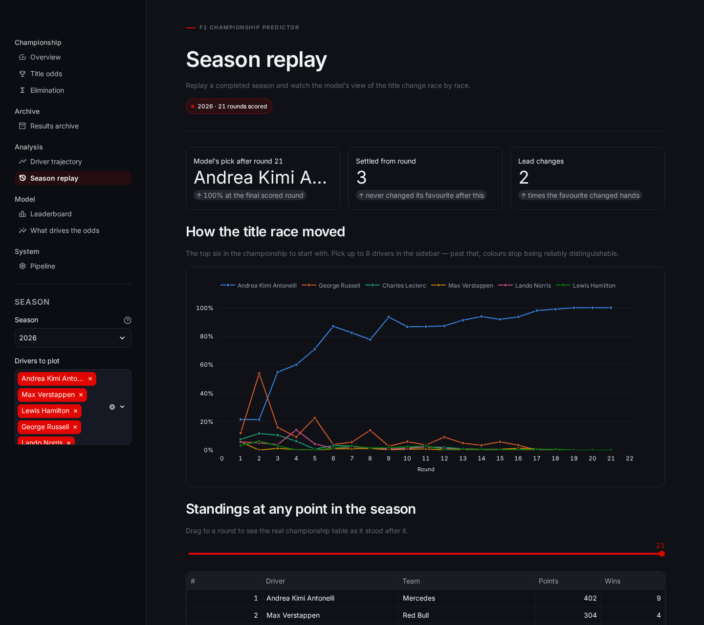
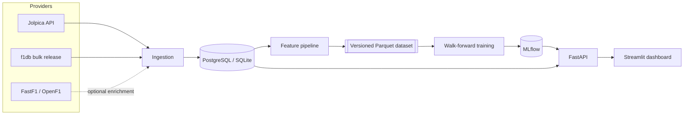

# F1 Championship Predictor

[](https://github.com/AntonioLoLa/f1-champion-predictor/actions/workflows/ci.yml)
[](https://github.com/AntonioLoLa/f1-champion-predictor/actions/workflows/data-sync.yml)
[](LICENSE)
[](pyproject.toml)

**After every Grand Prix, the probability that each driver wins that season's Formula 1
World Championship** — learned from every championship since 1950, validated on seasons
the model never saw, and updated automatically after each race weekend.

### ▶ Live app: **[f1-champion-predictor.streamlit.app](https://f1-champion-predictor.streamlit.app/)**

[](https://f1-champion-predictor.streamlit.app/)

The app follows the current title fight, replays any past season race by race, shows which
drivers are mathematically out of contention, and explains what moves each driver's odds.
It is a full ML system rather than a notebook: a data pipeline against public F1 data
providers, a leakage-tested feature layer, six competing model families tracked in MLflow,
calibrated probabilities, a FastAPI service and a Streamlit dashboard, all tested and
deployed by CI.

## The problem

Exactly **one driver wins the championship per season**. Since 1981 that is about 45
independent positive labels, not the 21,000 driver-round rows in the training set — and by
round 20 of 24 the title is often already decided. A single pooled ROC AUC on this problem
mostly measures how obvious the *late* rounds are.

So the project is built around three decisions:

- **Walk-forward validation, never a random split.** Each fold trains on all seasons up to
  year *N* and is tested on season *N+1*, so a season's ending never leaks into its own
  beginning. Every feature is computed from rounds strictly before the one being predicted,
  and a test asserts that deleting the future cannot change the past.
- **Probabilities that form a distribution.** Exactly one driver wins, so each round's
  probabilities are rescaled to sum to 1, and drivers who are mathematically eliminated are
  set to 0 by arithmetic, not by the model.
- **Metrics stratified by season phase, next to a baseline.** Every number below is shown
  against the trivial rule "the current championship leader wins the title".

## Results

Active model: **logistic regression**, selected from six candidates by mean per-round log
loss of the normalised distribution, over a 30-fold expanding walk-forward validation
(1981–2025). All numbers are out-of-fold: the model never saw the season it is scored on.

| Season phase | group log loss ↓ | top-1 hit rate ↑ | baseline (leader wins) |
|---|---|---|---|
| Early (< 33% of season) | 0.909 | 74.4% | 62.9% |
| Mid (33–67%) | 0.573 | 80.2% | 70.2% |
| Late (> 67%) | 0.408 | 86.0% | 84.7% |
| **All rounds** | **0.623** | **80.4%** | **73.0%** |

The model beats "the leader wins" by the widest margin early in a season, where the question
is genuinely open. Late in the season it barely beats the baseline, and that is expected:
the standings already hold the answer. Most of the remaining loss comes from genuinely
close championships such as 2007, 2010, 2012 and 2025.

Pooled diagnostics: ROC AUC 0.968, PR AUC 0.802, Brier score 0.0141 and expected
calibration error 0.0059 on the served, normalised probability.

<details>
<summary>All six candidates, and how the winner was chosen</summary>

| Model | Mean group log loss ↓ |
|---|---|
| **Logistic regression** (active) | **0.623** |
| LightGBM | 0.704 |
| Random forest | 0.731 |
| XGBoost | 0.936 |
| CatBoost | 1.080 |
| MLP | 1.435 |

Across the 30 folds, logistic regression's standard error is 0.098, so the
**one-standard-error rule** (`training/selection.py`) treats anything under 0.721 as
statistically indistinguishable: logistic regression and LightGBM tie, and the rule picks
the simpler model. With ~45 labels, the data cannot honestly separate them.
</details>

<details>
<summary>Feature ablation: do all 72 features earn their place?</summary>

Refitting the model on only its five most important features (by permutation importance:
`experience_seasons`, `team_points`, `career_starts`, `rounds_since_win`, `prior_titles`)
roughly doubles the loss — 1.232 against 0.615 with all 72, measured on the August 2026
training run over the same feature set. Most of the panel is doing real work.
</details>

## Limitations

- **n ≈ 45.** Every number above is an average over about forty-five completed
  championships, and a handful of close ones account for a large share of the loss. A
  different seed or fold count could plausibly reorder the top two models.
- **Historical rounds in the app are in-sample.** The served model is refit on almost
  every completed season, so replaying a past season shows results it has already seen.
  Every prediction carries an `is_out_of_sample` flag and the dashboard warns when it is
  false. The numbers in this README are always the out-of-sample, walk-forward ones.
- **No hyperparameter search.** The candidates' settings in `conf/models.yaml` were chosen
  by hand (shallow trees, explicit L2 regularisation). The comparison is between those
  configurations, not between fully tuned model families.
- **Calibration costs three seasons.** Each fold holds out its last three training seasons
  to fit the probability calibrator, so the calibrator never sees data the model was fit
  on. `Trainer`'s docstring explains why cross-fitted calibration was rejected.

## How it works



- **Data.** Every race since 1950 from the [f1db](https://github.com/f1db/f1db) bulk
  release, kept current from the [Jolpica](https://github.com/jolpica/jolpica-f1) API
  (the Ergast successor). Identities are reconciled across providers.
- **Features.** 72 per driver and round: championship standing and gap to the leader,
  points still available, recent form, qualifying, team strength, career history,
  and record at the circuits left on the calendar. Points features have era-normalised
  twins, because the scoring system has changed many times since 1950.
- **Models.** Logistic regression, random forest, XGBoost, LightGBM, CatBoost and an MLP,
  each calibrated (Platt) and explained with SHAP.
- **Serving.** Inference rebuilds features from the live database, never from the training
  dataset, so a prediction always reflects the latest ingested race.
- **Deployment.** A scheduled GitHub Actions workflow ingests new races twice a week and
  commits the refreshed database to the deploy branch, which redeploys the app. It
  retrains only when a season closes: until then the season has no champion and cannot be
  a training label (`training/cadence.py`).

The design rationale for each non-obvious decision lives in the docstring of the module
that made it. `openspec/specs/` describes the behaviour each part guarantees.

## Running it locally

### Docker Compose

```bash
cp .env.example .env
make up                    # postgres, mlflow, api, dashboard
make docker-pipeline       # ingest → build dataset → train → evaluate, inside the stack
```

API at <http://localhost:8000/docs>, dashboard at <http://localhost:8501>, MLflow at
<http://localhost:5000>.

### Without Docker (SQLite, no external services)

```bash
make setup                 # uv venv + editable install (Python 3.12)
make data                  # bootstrap from f1db, then incremental from Jolpica
make dataset
make train
make evaluate
make api                   # terminal 1: http://localhost:8000
make dashboard             # terminal 2: http://localhost:8501
```

Every setting in `conf/*.yaml` can be overridden from the environment; `.env.example`
lists them.

## API

| Method | Path | Purpose |
|---|---|---|
| GET | `/health` | Liveness and readiness |
| POST | `/predict` | Ranked title probabilities for one round (default: latest) |
| GET | `/predict-season/{season}` | Probabilities for every round of a season |
| GET | `/explain/{season}/{round}` | SHAP feature attributions for a round |
| GET | `/seasons/{season}/standings` | Driver standings after a round |
| GET | `/seasons/{season}/title-contention` | Who can still mathematically win |
| GET | `/seasons`, `/seasons/{season}/races` | Ingested seasons and calendars |
| GET | `/seasons/{season}/races/{round}/results` | Race results |
| GET | `/seasons/{season}/races/{round}/pit-stops` | Pit stops (2011+) |
| GET | `/model`, `/model/versions` | Active model and every trained version |
| POST | `/model/{id}/activate` | Promote a model version |
| POST | `/train`, GET `/train/{run_uuid}` | Start and poll a training run |
| POST | `/update-data` | Ingest new data |

The write endpoints are disabled when `API_READ_ONLY=true`, as on the public deployment.

```bash
curl -X POST localhost:8000/predict -H 'Content-Type: application/json' -d '{}'   # latest round
```

## Testing

```bash
make test       # unit, integration and e2e (excludes tests that need the network)
make lint       # ruff + black --check + mypy --strict
```

The integration tests use a real SQLite database, a real fitted model and a real MLflow
store, with no mocks of the project's own code. The end-to-end test runs provider →
ingestion → dataset → training → serving over a synthetic eight-season championship. CI
runs lint and tests on every push, then builds the Docker images and brings up the full
stack.

## Project layout

```
src/f1cp/
├── config/       # pydantic settings, loaded from conf/*.yaml + environment
├── domain/       # scoring rules by era, elimination arithmetic, season phases
├── data/         # providers (Jolpica, f1db, FastF1, OpenF1, Kaggle), ingestion
├── db/           # SQLAlchemy models, repositories, Alembic migrations
├── features/     # feature blocks and the leakage-safe pipeline
├── dataset/      # database → versioned Parquet dataset
├── models/       # model zoo, calibration, per-round normalisation
├── training/     # walk-forward splits, trainer, model selection, MLflow
├── evaluation/   # phase-stratified metrics and reports
├── explain/      # SHAP and permutation importance
├── inference/    # live prediction service
├── api/          # FastAPI app
├── dashboard/    # Streamlit app
└── cli.py        # `python -m f1cp.cli`; scripts/*.py are thin wrappers
```

<details>
<summary>Working on the deploy branch</summary>

`deploy/streamlit-cloud` tracks `data/f1cp.db`, `data/mlflow.db` and `mlruns/`. MLflow
stores absolute artifact paths from the machine that trained last, so after pulling that
branch run `make relocate-mlflow` before serving or evaluating locally (the Streamlit
entrypoint and CI do this themselves). See `f1cp.training.tracking.relocate_artifact_paths`.
</details>

## Tech stack

Python 3.12 · scikit-learn · XGBoost · LightGBM · CatBoost · polars · pandas · SQLAlchemy 2
· Alembic · PostgreSQL · MLflow · SHAP · FastAPI · Streamlit · Plotly · pytest · Ruff ·
Black · mypy (strict) · Docker Compose · GitHub Actions

## License

MIT — see [LICENSE](LICENSE). F1 data courtesy of [f1db](https://github.com/f1db/f1db) and
[Jolpica](https://github.com/jolpica/jolpica-f1). This project is unofficial and not
associated with Formula 1 or the FIA.
